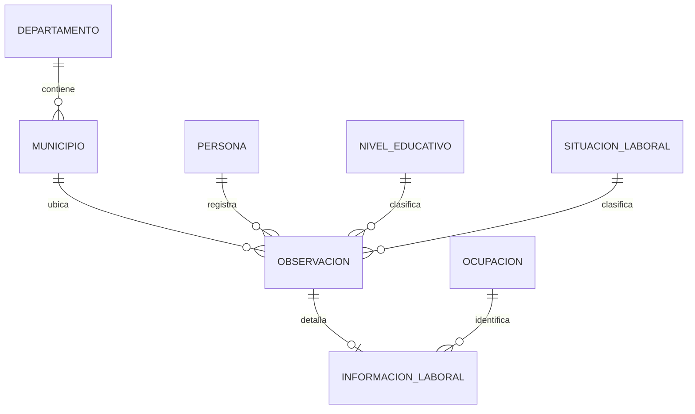
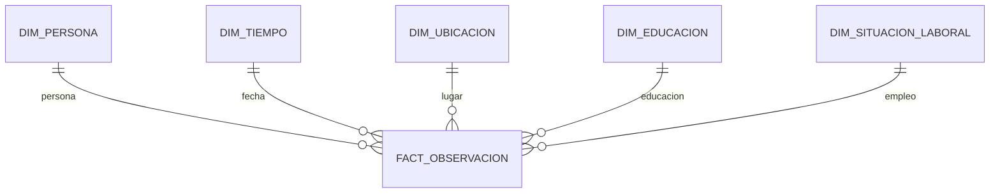

# Modelos de datos

## Modelo relacional

La persona se identifica de forma única por tipo y número de documento. La observación se identifica por persona y fecha de encuesta. Los catálogos y la ubicación se separan para conservar la normalización.

## Modelo multidimensional

La granularidad de `FactObservacion` es una observación por persona y fecha de encuesta. Las dimensiones usan claves sustitutas y la tabla de hechos conserva el identificador de origen para controlar la idempotencia.
